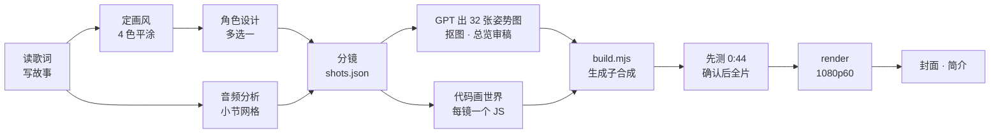

# 勾指起誓 · 小克 × DeepSeek 同人 MV — 工程仓库

> 洛天依 / ilem《勾指起誓》的同人 MV。
> **画面全部由代码逐帧绘制，没有使用视频生成模型**；只有角色立绘由 GPT 生成，抠图后作为图层放进代码画的世界里。
> 故事、分镜、全部代码、渲染和修图，都由 Claude（Claude Code）在和作者的对话中完成；作者负责定方向、审稿、拍板。

| 规格 | |
|---|---|
| 时长 | 3:03.5，1920×1080，60 fps |
| 镜头 | 59 个，全部卡在 170 BPM 的小节线上（130 小节，一小节 1.412 s） |
| 角色图 | 32 张 GPT 生成的姿势图（小克 17 / DeepSeek 13 / 勾指特写 2） |
| 代码 | 引擎约 830 行 JS + 59 个镜头约 1,070 行 JS + 约 320 行 Python 工具 |
| 渲染 | 本地 GPU 截帧，全片约 5–11 分钟 |

---

## 技术栈

| 环节 | 用的东西 | 说明 |
|---|---|---|
| 写故事 / 分镜 / 代码 / 修图 | **Claude Code**（Claude Opus） | 作者只用自然语言下指令和审稿，没有手写代码 |
| 视频引擎 | **[HyperFrames](https://github.com/heygen-com/hyperframes)** 0.9.10 + GSAP | HeyGen 开源的「HTML → 视频」框架：每个镜头是一个 HTML 子合成，按时间轴逐帧截图、合成 MP4 |
| 画面 | 原生 **Canvas 2D** | 天空、海、图书馆、深海、鲸鱼、终端、对话气泡、UI 全是代码画的平涂图形 |
| 角色立绘 | **GPT 图像生成**（通过 Codex CLI 调用） | 角色设定图作参考，绿幕或透明背景出图 |
| 抠图 | Python + Pillow + NumPy | 自写的 `tools/key.py`，支持绿幕和自带透明两种输入 |
| 音乐分析 | **librosa** | 检测节拍 → 直线拟合出小节网格，所有镜头时间都从这里来 |
| 字体 | Noto Sans SC / Noto Serif SC | 用 fontTools 只保留用到的字，打成 woff2 |
| 封面 / 风格帧 | 无头 Chrome | 用同一套绘图引擎画，截图出三种比例 |

## 工作流



**1. 读歌词，写故事**（`故事_v1.md`）
歌词只用来理解情绪和结构，**画面上不排歌词**，底部 160 px 留给作者自己加字幕。

**2. 定画风**
4 色平涂丝网印刷海报风。每个角色严格限定 4 种颜色，代码画的世界也只用这些颜色，不用渐变：

- 小克：`#F0EEE6` `#F2C6A8` `#D97757` `#3B2620`
- DeepSeek：`#F0EEE6` `#B8C3F7` `#4D6BFE` `#1B1F4B`
- 金色 `#F3C969` 只留给「约定」的那根线

**3. 角色设计**
每个角色出几版候选，用代码画的风格帧（`styleframe/`）放在 MV 场景里对比，作者选定后存为定稿立绘（`assets/cast/`），后面所有出图都拿它当参考。

**4. 音频分析 → 小节网格**
```
python scripts/analyze_audio.py assets/audio/song.mp3 analysis/audio.json   # librosa 测节拍和能量
python scripts/bars.py analysis/audio.json assets/audio/song.lrc analysis/bars.json  # 拟合 170 BPM 小节网格
```
`bars.json` 里每一小节的起止时间，是之后所有镜头切点和动画卡点的唯一来源。

**5. 分镜**（`storyboard/shots.json`）
每个镜头记录：占哪几个小节、画什么、用哪几张角色图、屏幕上有什么文字。`scripts/shotlist.py` 把它转成可读的 `分镜表_v1.md`，同时检查每个小节恰好被一个镜头覆盖、每张角色图都有定义。

**6. 角色姿势图**
- `prompts/pose_build.py` 拼出每张图的提示词：角色描述 + 色板 + 姿势 + 风格（`prompts/_style_pose.txt`），参考图是定稿立绘。
- `tools/batch.ps1` 并行调用 `tools/gen.ps1`（Codex CLI 出图，并行不超过 3 个，否则容易被限流）。
- `tools/key.py` 抠图，`tools/sheet.py` 拼成总览图给作者审稿。

**7. 代码画世界**
- `src/lib/mv.js`：运行时。每个镜头一条 GSAP 时间轴推动一个时钟，HyperFrames 跳到任意一帧都能重画。
- `src/lib/gx.js`：色板、缓动、小节/节拍时间（`GX.bar(b)`、`GX.beatT(i)`、`GX.pulse`）、镜头运动、抖动、颗粒、文字、窗口面板等绘图工具。
- `src/lib/world.js`：场景和 UI 部件，比如天空、海、图书馆、深海、鲸鱼、终端、对话气泡、「第 N 次初次见面」计数器、「已深度思考」芯片。
- `src/scenes/Sxx.js`：每个镜头一个文件，写成 `SCENE(function (g, t, T) { … })`，也就是「给定时间，画出这一帧」的纯函数。

**8. 构建**
```
node scripts/build.mjs            # 生成 compositions/Sxx.html + index.html + 字体子集
node scripts/build.mjs --upto S15 # 只构建前 15 个镜头（测试片段）
```

**9. 预览、检查、渲染**
```
npx hyperframes@0.9.10 preview
npx hyperframes@0.9.10 check
npx hyperframes@0.9.10 snapshot . --at 62,128,173   # 截几帧看
npx hyperframes@0.9.10 render . --fps 60 --quality looks -o renders/mv.mp4
```
先做 0:00–0:44 的测试片段，作者确认画风和节奏后再做全片。

**10. 封面**
`covers/cover.html` 用同一套引擎画 16:9 / 4:3 / 3:4 三种比例，用 `tools/shot.ps1` 调无头 Chrome 截图。

## 几条核心原则

- **确定性渲染**：每一帧只取决于时钟。随机数只用带种子的 `MV.rng`，而且每一帧都要把所有随机数完整取一遍；中途少取一个，后面的数就全错位，画面会闪。
- **一切卡小节**：镜头切点、闪光、爆点全部从 `bars.json` 算，不手填秒数。
- **角色图是图层，不是背景**：半身图和特写的头发被图像左右边裁成了直线，所以只放进 UI 窗口里，或者贴着画面边缘用，不能悬空摆在画面中间。
- **严格色板**：同色系的元素放在一起会糊掉，比如奶油色边框配奶油色底、金线配金色背景，要靠深色边框或撞色分开。

## 踩过的坑

| 问题 | 解决 |
|---|---|
| GPT 有时直接返回透明背景的 PNG，有时是绿幕 | `key.py` 两种模式都支持：透明的裁掉 1–19 的半透明光晕，绿幕的从边缘采样键色 |
| 抠完头发边缘发绿 | 每个像素把绿通道压到不超过 max(R, B) |
| 特写图边缘被头发污染，键色取错 | 只从「看起来是绿色」的边缘像素采样 |
| 半身图放进窗口后脸被裁掉 | 图片宽度撑满窗口，从顶部往下挂 |
| **手指**：GPT 画的勾指连续几轮出错，比如六根手指、小指长错位置、细长得像面条 | 先放大数手指再交付。最后真正有效的做法：**一张真人勾指照片管姿势，作者认可的初版管画风**，画错的版本一律不再当参考，否则越改越歪 |
| 画面一帧一闪 | 某个分支里少取了一个随机数，改成每帧取满 |
| Windows PowerShell 5.1 读 UTF-8 文件默认按 GBK，中文变乱码，整个场景跑不起来 | 读写文件时显式指定 UTF-8 编码 |

## 目录结构

```
├─ 故事_v1.md / 分镜表_v1.md / 简介.md   故事、分镜表、投稿简介
├─ storyboard/shots.json                 分镜数据（镜头 ↔ 小节 ↔ 角色图）
├─ analysis/                             节拍分析和小节网格
├─ src/lib/                              引擎：mv.js 运行时 / gx.js 绘图工具 / world.js 场景部件
├─ src/scenes/S01–S59.js                 59 个镜头
├─ scripts/                              音频分析、分镜表、构建
├─ tools/                                出图（Codex）、抠图、总览、截图
├─ prompts/                              全部出图提示词（含各轮重画）
├─ assets/cast/                          定稿立绘
├─ assets/poses/cut/                     32 张抠好的姿势图
├─ styleframe/                           风格帧
└─ covers/                               封面（cover.html + 三种比例）
```

## 自己跑起来

**需要**：Node 18+、Python 3.10+（`pip install librosa numpy pillow fonttools`）、Chrome；HyperFrames 用 `npx` 自动下载。出图还需要 Codex CLI 和 ChatGPT 账号（可以用环境变量 `CODEX_CMD` 指定 codex 的路径）。

1. 自备音频，放到 `assets/audio/song.mp3`（本仓库**不含原曲音频和歌词**）。
2. `node scripts/build.mjs`
3. `npx hyperframes@0.9.10 preview` 预览，或 `render` 导出。

字体说明：`build.mjs` 从 `C:/Windows/Fonts` 读取 Noto Sans SC、Noto Serif SC 和 Consolas 来做子集。Consolas 是微软的专有字体，仓库里没有附带它的子集；可以换成 JetBrains Mono 或 Noto Sans Mono（改 `build.mjs` 里 `consola.ttf` 那一行）。

## 致谢与声明

- 画面形式受 @真寻Mahiro《病名は愛だった》MV（BV1VBno6KEEc）启发：代码画世界 + AI 画角色。
- 歌曲：《勾指起誓》，演唱 洛天依，作词 / 作曲 / 编曲 ilem，混音 Tolein。本仓库不包含音频和歌词。
- 角色立绘由 AI（GPT）生成。小克为作者自设，DeepSeek 为本片原创的蓝发鲸鱼女仆设定。
- 非官方同人作品，与 Anthropic、DeepSeek、OpenAI 无关。
- 许可：本仓库内容（代码与图片）以 [MIT 协议](LICENSE) 开源。不包括原曲音频与歌词（未收录），也不包括第三方工具 HyperFrames、GSAP 和 Noto 字体，它们各自遵循自己的许可。
